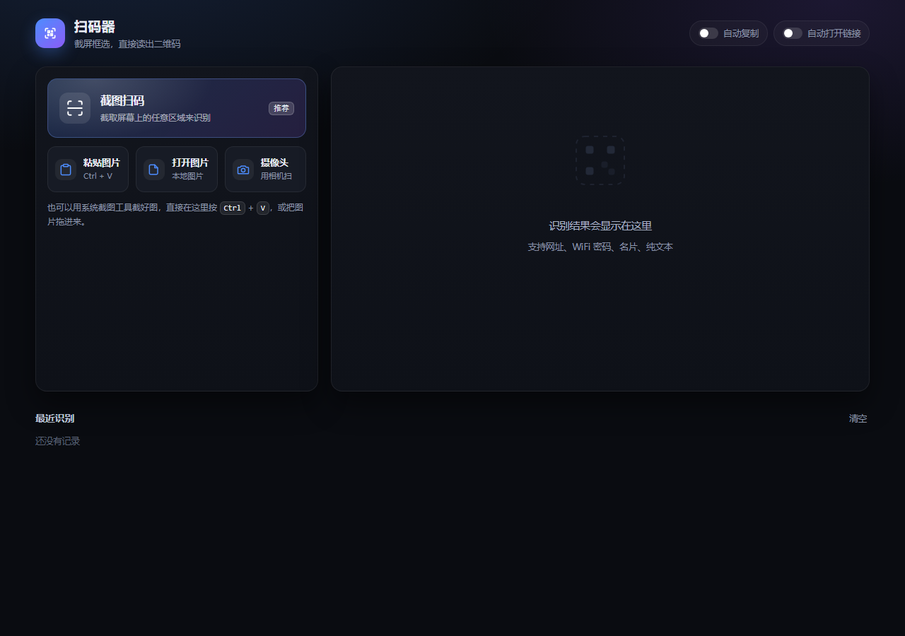

# 扫码器 · 电脑端截图识别二维码

截一块屏幕，直接把里面的二维码读出来。全程在本机完成，不联网、不上传。



## 怎么用

**免安装版**：双击 `dist\扫码器.exe`（约 330 KB，单文件，不需要装 Node，也不需要在旁边放任何文件）。前端资源全部嵌在 exe 里。

**开发版**：双击 `启动扫码器.bat`（想省掉黑窗口就用 `后台启动扫码器.vbs`），方便改完前端立刻看效果。

两种方式都会弹出一个独立窗口，接着是：

1. 点 **截图扫码** → 选要截的屏幕或窗口 → 按住鼠标拖框住二维码 → 松开就出结果
2. 结果可以复制，网址可以直接打开；识别过的条目留在「最近识别」里

其它几个入口：

| 入口 | 用法 |
| --- | --- |
| 粘贴图片 | 先用系统截图工具截图（`Win+Shift+S`），回到这里按 `Ctrl+V` |
| 打开图片 | 识别磁盘上已有的图片文件 |
| 拖拽 | 直接把图片文件拖进窗口 |
| 摄像头 | 用相机对着屏幕/纸面扫，自动连续识别 |

## 能识别什么

- 网址、纯文本
- WiFi 密码（会拆成 SSID / 密码 / 加密方式分开显示，密码单独可复制）
- 名片（vCard：姓名、单位、电话、邮箱）
- 邮件、电话、短信、地理位置

另外：

- 一张图里有多个二维码会依次全部列出
- 整屏截图里的小码也能找到（分块扫描 + 放大重试）
- 黑底白码（反色二维码）同样能读
- 自动复制、自动打开链接两个开关；历史保留最近 24 条

## 为什么需要启动一个小服务

浏览器只在安全上下文（`https` 或 `localhost`）下才允许捕获屏幕 —— `getDisplayMedia` 在 `file://` 下拿不到权限。所以双击 `index.html` 是没法截图扫码的。

启动脚本会拉起一个零依赖的小服务（`server.js`，只监听 `127.0.0.1`，默认 7457 端口，被占用时自动往后找），再用 Edge 以独立窗口打开它。关掉窗口后服务会在 20 分钟内自动退出。

## 单文件 exe

`dist\扫码器.exe` 是把整个工具塞进一个文件的结果：

- **免安装、零外部依赖**：页面、样式、脚本、识别库全部作为资源嵌在 exe 里，双击就能跑
- 只依赖系统自带的 .NET Framework 4.x（Windows 10/11 都自带；更老的系统装一下 4.8 即可）
- 启动后：exe 自己起一个只监听 `127.0.0.1` 的小服务，再用 Edge 的 app 窗口把页面打开 —— 所以窗口没有地址栏和标签页，看起来就是个独立小应用
- 重复双击不会起第二份服务：探测到端口上已有本程序，就只把窗口调出来
- 关掉窗口后 20 分钟没有访问，进程自己退出，不会常驻后台
- 运行日志写在 exe 旁边的 `qrscan.log`（只在出问题时有用）

从源码重建：双击 `build-exe.bat`。它调用系统自带的 `csc.exe` 编译 `src\Program.cs` 并把前端资源一起嵌进去，不需要 Visual Studio 或任何 SDK。exe 图标由 `node tools/make-icon.js` 程序化生成（`icon.ico`）。

在 GitHub 网页上想直接拿这个 exe：点开 `dist/扫码器.exe`，再点右上角的下载按钮（网页无法预览二进制文件，但可以下载）。

## 目录结构

| 路径 | 作用 |
| --- | --- |
| `dist\扫码器.exe` | 免安装单文件版 |
| `build-exe.bat` / `src\Program.cs` | 单文件版的构建脚本与启动器源码（内嵌资源 + 本地服务 + 开窗口） |
| `启动扫码器.bat` / `后台启动扫码器.vbs` | 开发版的启动入口 |
| `server.js` | 开发版用的零依赖静态服务 |
| `index.html` / `styles.css` | 界面 |
| `app/app.js` | 界面逻辑：屏幕捕获、框选、粘贴、摄像头、结果渲染 |
| `app/decode.js` | 解码核心：分块扫描、反色、多码、内容解析 |
| `vendor/jsQR.js` | 二维码识别库（jsQR 1.4.0） |
| `tests/` | 单元测试与测试图 |
| `tools/make-icon.js` | 生成 exe 图标 |

## 测试

```bash
npm test
```

11 项单元测试，覆盖解码、多码、反色、小码、各类内容解析。

界面自检：启动后打开 `http://127.0.0.1:7457/index.html?selftest=1`，页面底部会打印 5 项检查结果，标题栏变成 `SELFTEST PASSED`。

## 已知限制

- 主要在 Windows + Edge 上验证；其它 Chromium 内核浏览器理论上也可以，Firefox 的屏幕捕获行为不同，未适配
- 摄像头模式需要授权，笔记本内置摄像头对着屏幕拍容易失焦，效果不如直接截图
- 二维码边长小于约 40 像素、或者模糊/反光严重时识别不出来，这时框小一点反而更容易成功

## 隐私

识别全部在本机浏览器与本地进程里完成，没有任何网络上报，也不会写入除浏览器 localStorage 之外的任何位置（历史记录、开关状态存在 localStorage）。
